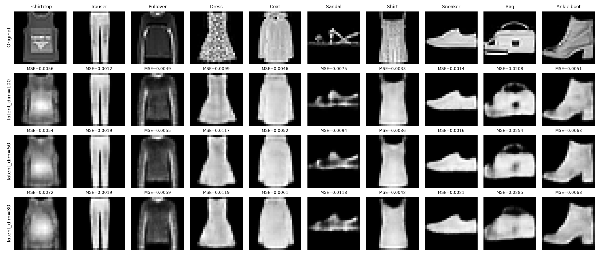

# Questão 5 — Autoencoder (Fashion-MNIST): teoria, arquitetura e resultados

> Este documento resume a teoria, as decisões de arquitetura e os resultados obtidos na
> implementação da Questão 5 (ver `PLAN_IMPLEMENTACAO.md` para a especificação completa e
> `README.md` para o enunciado original). Serve de material-fonte para montar uma
> apresentação sobre o trabalho.

## 1. Contexto do problema

Um **autoencoder** é uma rede neural treinada para reconstruir sua própria entrada,
passando por um "gargalo" (espaço latente) de dimensão muito menor que a entrada original.
Ele é composto por duas partes:

- **Encoder**: comprime a imagem de entrada em um vetor latente `z`, de dimensão `latent_dim`.
- **Decoder**: tenta reconstruir a imagem original a partir de `z`.

Como o gargalo força a rede a reter apenas a informação mais relevante, o autoencoder
aprende uma representação compacta dos dados — uma forma de compressão/aprendizado não
supervisionado, já que não usa os rótulos de classe (0 a 9) do Fashion-MNIST em nenhum
momento, apenas as imagens.

Usamos o dataset **Fashion-MNIST**: 70.000 imagens em escala de cinza, 28x28 pixels, de
peças de roupa/calçados em 10 categorias (T-shirt, calça, vestido, tênis, bolsa, etc.).

## 2. Arquitetura geral (comum a todos os experimentos)

### 2.1 Por que convolucional, e não densa?

O enunciado permite tanto camadas densas quanto convolucionais. Optamos por
**convolucional** porque imagens têm estrutura espacial local (bordas, texturas, formas)
que camadas convolucionais capturam naturalmente através de filtros compartilhados —
diferente de uma camada densa, que trataria cada pixel como uma feature independente,
perdendo a noção de vizinhança e exigindo muito mais parâmetros para o mesmo poder
representacional.

### 2.2 Encoder

```
Entrada (1, 28, 28)
  -> Conv2d(1  -> 16, kernel=3, stride=2, padding=1) -> ReLU   # (16, 14, 14)
  -> Conv2d(16 -> 32, kernel=3, stride=2, padding=1) -> ReLU   # (32, 7, 7)
  -> Conv2d(32 -> 64, kernel=3, stride=2, padding=1) -> ReLU   # (64, 4, 4)
  -> Flatten()                                                  # (1024,)
  -> Linear(1024 -> latent_dim)                                 # (latent_dim,)  [sem ativação]
```

- **Cada `Conv2d` usa `stride=2`**, o que reduz a resolução espacial pela metade a cada
  camada (28→14→7→4), enquanto o número de canais aumenta (1→16→32→64). A ideia é trocar
  "resolução espacial" por "riqueza de representação": conforme a imagem fica menor,
  cada posição do mapa de ativação passa a representar uma região maior da imagem
  original, codificada em mais canais.
- **ReLU** depois de cada convolução introduz não-linearidade — sem isso, empilhar várias
  camadas lineares equivaleria a uma única transformação linear, limitando muito o que a
  rede consegue aprender.
- **`Flatten()`**: depois da última convolução, a ativação tem formato `(64, 4, 4)` — um
  tensor 3D (canais, altura, largura). Para conectar isso a uma camada `Linear` (que espera
  um vetor 1D), o `Flatten()` simplesmente "desenrola" esse tensor em um vetor de
  `64 * 4 * 4 = 1024` valores, sem alterar nenhum dado — só a forma como ele é indexado.
- **`Linear(1024 -> latent_dim)`**: a camada que de fato produz o vetor latente. É o
  "gargalo" do autoencoder — `latent_dim` (100, 50 ou 30 no item a) é bem menor que 1024,
  forçando a rede a comprimir a informação.
- **Sem ativação após essa `Linear` final**: o vetor latente fica livre para assumir
  qualquer valor real (positivo ou negativo), sem restrição de sinal ou faixa. Isso é a
  escolha padrão para o espaço latente — diferente da saída final do decoder (ver 2.3),
  o latente não precisa representar pixels, só a codificação interna da imagem.

### 2.3 Decoder (espelha o encoder)

```
Latente (latent_dim,)
  -> Linear(latent_dim -> 1024) -> ReLU
  -> Unflatten(64, 4, 4)                                              # (64, 4, 4)
  -> ConvTranspose2d(64 -> 32, kernel=3, stride=2, padding=1, output_padding=0) -> ReLU  # (32, 7, 7)
  -> ConvTranspose2d(32 -> 16, kernel=3, stride=2, padding=1, output_padding=1) -> ReLU  # (16, 14, 14)
  -> ConvTranspose2d(16 -> 1,  kernel=3, stride=2, padding=1, output_padding=1) -> Sigmoid # (1, 28, 28)
```

- **`Linear(latent_dim -> 1024)` + ReLU**: primeiro passo do decoder, expande o vetor
  latente de volta para 1024 valores — o "caminho inverso" da última camada do encoder.
  Aqui a ReLU faz sentido (diferente do encoder): esta não é a camada do latente em si, é
  uma etapa intermediária de expansão, então recebe não-linearidade como qualquer outra
  camada interna.
- **`Unflatten`**: operação inversa do `Flatten()` do encoder — pega o vetor de 1024 valores
  e o reorganiza de volta no formato `(64, 4, 4)`, para que as próximas camadas possam
  tratá-lo como um mapa de ativação espacial novamente (canais, altura, largura).
- **`ConvTranspose2d`** ("deconvolução"): o inverso aproximado da `Conv2d` — em vez de
  reduzir a resolução espacial, ela a aumenta (4→7→14→28), enquanto o número de canais
  diminui (64→32→16→1), espelhando exatamente a progressão do encoder ao contrário.
- **`output_padding`**: por causa do arredondamento (`floor`) na fórmula da convolução do
  encoder, a operação inversa é ambígua — por exemplo, tanto uma entrada 13 quanto 14
  produzem saída 7 na conv original. O `output_padding` resolve essa ambiguidade,
  adicionando o pixel exato que foi "perdido" no arredondamento, garantindo que a saída
  final seja exatamente `(1, 28, 28)` — do mesmo tamanho da imagem original.
- **Sigmoid na última camada**: como as imagens de entrada são normalizadas para o
  intervalo `[0, 1]` (via `ToTensor()`, sem normalização adicional), a Sigmoid restringe a
  saída da rede a esse mesmo intervalo — essencial para que o erro de reconstrução
  (MSE) compare valores na mesma escala da entrada.

### 2.4 Treino: função de perda e otimizador

- **Função de perda: `MSELoss`** (erro quadrático médio). Como o problema é reconstruir
  pixels contínuos em `[0,1]` — não classificar categorias — isso é uma tarefa de
  **regressão**, não de classificação, então `CrossEntropyLoss` não se aplica aqui.
- **Otimizador: Adam** (`lr=1e-3`), escolha padrão para treino de redes profundas por
  combinar bem convergência rápida e estabilidade.
- **20 épocas** de treino em todos os experimentos, com `batch_size=128`.
- **Rótulos de classe (0-9) nunca são usados no treino** — o autoencoder só vê as imagens;
  os rótulos só servem, depois, para nomear as categorias nos gráficos de avaliação.

### 2.5 Avaliação

Em todos os experimentos (item a e b), a avaliação usa **as mesmas 10 imagens do conjunto
de teste — uma por categoria** (as 10 classes do Fashion-MNIST), sorteadas com seed fixa
(`seed=42`) a partir dos rótulos do dataset, nunca escolhidas manualmente. Isso garante que
a comparação entre os modelos (3 latentes no item a; limpo vs. ruidoso no item b) seja
sempre sobre o mesmo conjunto de imagens.

O erro de cada imagem individual é o **MSE entre a reconstrução e o alvo** (a imagem
limpa original), calculado pixel a pixel e depois tirando a média dentro de cada imagem
— por isso cada imagem no gráfico tem sua própria anotação `MSE=...`.

---

## 3. Item (a) — Autoencoder "simples" com 3 tamanhos de espaço latente

### 3.1 O que muda entre as 3 variantes

A arquitetura (número de camadas, canais, etc.) é **idêntica** nas 3 variantes — a única
diferença é o tamanho do vetor latente: `latent_dim` ∈ {100, 50, 30}. Esse é exatamente o
parâmetro do "gargalo" discutido na seção 2.2: quanto menor, mais a rede é forçada a
comprimir/descartar informação da imagem original.

Cada variante foi treinada do zero por 20 épocas, usando apenas a entrada original como
alvo (sem ruído). Antes de criar cada modelo, chamamos `torch.manual_seed(42)` — a mesma
seed nas 3 variantes — para que a inicialização dos pesos parta sempre do mesmo estado do
gerador aleatório. Vale notar uma nuance: como as camadas `Linear` do gargalo têm tamanhos
diferentes em cada variante (`Linear(1024, latent_dim)` e vice-versa), a inicialização dos
pesos consome uma quantidade diferente de números aleatórios em cada caso — então a ordem
de embaralhamento dos batches durante o treino (`shuffle=True`), que depende do estado
global do gerador no momento em que o treino começa, acaba divergindo ligeiramente entre as
3 variantes. Ou seja, a seed garante inicializações reprodutíveis, mas `latent_dim` não é
*estritamente* a única fonte de variação entre os 3 treinos — a ordem dos dados também
varia como efeito colateral do tamanho das camadas.

### 3.2 Resultados

| latent_dim | Erro médio de reconstrução (MSE, 10 imagens de teste) |
|---|---|
| 100 | 0.006429 |
| 50  | 0.007604 |
| 30  | 0.008644 |

O erro cresce de forma consistente conforme o espaço latente diminui — exatamente o
comportamento esperado: menos "espaço" para codificar a imagem leva a reconstruções menos
fiéis.

### 3.3 Comparação visual



Observações sobre a figura:
- A linha "Original" mostra as 10 imagens de teste (uma por categoria).
- Cada linha seguinte mostra a reconstrução de um modelo (`latent_dim=100`, depois `50`,
  depois `30`), com o MSE daquela imagem específica anotado acima dela.
- Com `latent_dim=100`, os contornos gerais e até alguns detalhes de textura ainda
  aparecem (ex: as listras da calça, o padrão do vestido fica borrado mas presente).
- Conforme `latent_dim` cai para 50 e depois 30, detalhes finos (texturas, estampas,
  como o padrão xadrez do vestido ou o desenho da sandália) se perdem progressivamente,
  mas a forma geral do objeto (silhueta) permanece reconhecível mesmo com `latent_dim=30`
  — mostrando que a informação de "forma" é mais compacta e fácil de preservar que
  "textura/detalhe fino".
- A bolsa (`Bag`) tem consistentemente o maior MSE entre as 10 categorias em todas as
  variantes — provavelmente por ter mais detalhes internos (alça, fivela, bolso) que o
  autoencoder tem mais dificuldade de reconstruir com precisão.

---

## 4. Item (b) — Autoencoder denoising

### 4.1 Diferença em relação ao item (a)

**Mesma arquitetura-base** do item (a) (seção 2), com `latent_dim=100` (o maior dos três
testados, escolhido para dar à rede o máximo de capacidade disponível para a tarefa mais
difícil de "separar" sinal de ruído). A única mudança está em **o que a rede recebe como
entrada durante o treino**:

- Item (a): entrada = imagem original, alvo = a mesma imagem original.
- Item (b): entrada = imagem original **+ ruído Gaussiano sintético**, alvo = a imagem
  original **limpa** (sem ruído).

Isso força a rede a aprender não só a comprimir/reconstruir a imagem, mas a **diferenciar
o que é ruído do que é sinal real** — ela só reduz a perda se aprender a "filtrar" o ruído,
já que o alvo nunca tem ruído.

O ruído é gerado como `imagem + std * N(0,1)` (ruído Gaussiano de média 0 e desvio-padrão
`std`), com o resultado sempre saturado de volta ao intervalo `[0,1]` (`clamp`), para
manter a mesma faixa de valores usada em todo o resto do pipeline.

A avaliação usa **as mesmas 10 imagens fixas do item (a)** (mesma seed), para permitir
comparação direta: a entrada do modelo passa a ser a versão ruidosa dessas 10 imagens, mas
o erro de reconstrução continua sendo medido contra a versão limpa original.

### 4.2 Duas intensidades de ruído testadas

Testamos dois valores de `std` (desvio-padrão do ruído) para entender o efeito da
intensidade do ruído tanto na dificuldade do treino quanto na qualidade subjetiva da
remoção:

| std_ruido | Erro médio de reconstrução (MSE, 10 imagens) |
|---|---|
| 0.3 | 0.010207 |
| 0.1 | 0.007536 |

Com ruído mais forte (`std=0.3`), a tarefa é mais difícil (maior erro final), mas também é
um teste mais exigente da capacidade de denoising do modelo. Com `std=0.1`, a entrada já é
visualmente mais próxima da imagem original, e por isso o modelo consegue reconstruir com
menor erro.

### 4.3 Comparação visual — std_ruido = 0.3

.png)

### 4.4 Comparação visual — std_ruido = 0.1

.png)

Observações sobre as duas figuras:
- As 3 linhas são: imagem original limpa, imagem com ruído adicionado (entrada real do
  modelo) e a reconstrução produzida pelo autoencoder denoising.
- Em ambos os casos, o modelo recupera claramente a silhueta e os contornos principais do
  objeto, removendo a maior parte do ruído granulado visível na linha "Ruidosa" —
  evidência de que a rede aprendeu a distinguir estrutura de ruído aleatório, e não apenas
  a copiar a entrada.
- Com `std=0.3` a imagem ruidosa fica visivelmente mais "suja" (mais pixels fortemente
  alterados) que com `std=0.1`, mas mesmo nesse caso mais difícil a reconstrução ainda
  preserva a forma reconhecível do objeto — ainda que com mais perda de detalhe fino
  (texturas) do que na versão com `std=0.1`.
- A categoria "Bag" volta a ser a de maior erro em ambas as intensidades de ruído,
  consistente com o observado no item (a): é a categoria com mais detalhes internos finos.
